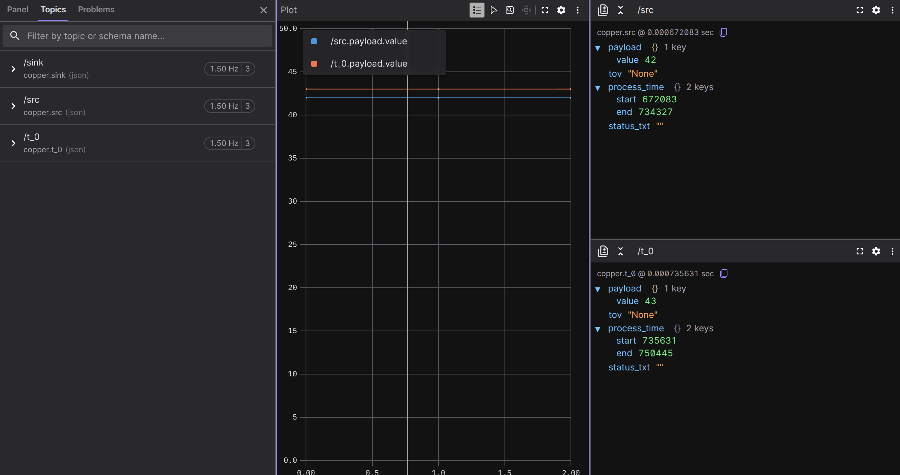

# Exporting Data to Other Formats

In the [logging chapter](./logging-replay.md), we learned how Copper records everything
into `.copper` files and how the log reader can extract text logs and CopperList data as
JSON. But JSON is just the beginning. Real-world workflows often need data in other
formats -- CSV for spreadsheets and data science tools, MCAP for visualization in
[Foxglove](https://foxglove.dev/), or statistics JSON for offline performance analysis.

The log reader CLI you already have supports all of these. In this chapter, we'll explore
every export format and diagnostic tool available in `cu29-export`.

## Choose a reader

For the wheel recording from the previous chapter, use the standalone
`just logextract` reader or the example's `just` recipes. For your first
project's log, use the matching `src/logreader.rs` binary from
[Logging and Replaying Data](./logging-replay.md#step-2-the-log-reader).
The following sections state the starting directory for each command.

## Inspecting a self-describing recording

<span class="version-marker" data-version="1.3">v1.3+</span>

Continue from the ten-cycle wheel recording in
[Self-Describing Logs](./self-describing-logs.md#1-try-a-complete-recording).
That chapter covers recording, payload descriptions, storage units, and your
first JSONL export. Here we use the existing log to export the catalog and
inspect storage costs.

### Export the catalog

From the copper-rs repository root, enter the example directory you used earlier:

```sh
cd examples/cu_self_describing_logs
just catalog --export-format ron > catalog.ron
just catalog --export-format json > catalog.json
```

These files include the complete field descriptions, mission output-slot maps,
and recorded configuration. Use them when another tool needs the descriptions.

For your own log, run `just logextract <base-path> catalog --export-format json`
from the repository root, substituting its base path. For multiple runs, see
[Selecting a recorded run](#selecting-a-recorded-run).

### Interpret missing payloads

When inspecting JSONL exports, use capture status to distinguish an absent
payload from one excluded by logging. Compact recordings preserve that
information; flat recordings can lose the original presence information when
capture is suppressed. Each exported cycle retains its slot identity,
payload, time of validity, and metadata.

### Use an existing application logreader

App logreaders use their native typed decoder by default. If the logreader's
`cu29-export` dependency enables `self-describing-logs`, run this from the
application directory to select the catalog:

```sh
logreader logs/robot.copper extract-copperlists --decoder catalog
```

Structured text still requires the producing build's string index. For direct
Python access to the catalog and decoded dictionaries, follow
[Catalog-Based Offline Analysis](./python.md#catalog-based-offline-analysis).

## Selecting a recorded run

<span class="version-marker" data-version="1.3">v1.3+</span>

A unified log can contain several runs, for example when you append a restart or
construct another mission. Each run has its own CopperList sequence and clock.
Use the application's built logreader to find the run you want:

```sh
logreader logs/robot.copper list-runs
logreader logs/robot.copper --run 1 fsck --dump-runtime-lifecycle
logreader logs/robot.copper --run 1 extract-copperlists
```

Run these commands from the application directory. Here `logreader` means its
built logreader executable. With the standalone reader, use
`just logextract <base-path> list-runs` from the copper-rs repository root, then
put `--run N` before the subcommand. Indices are zero-based and follow the
first retained section of each run. They differ
from `instance_id`, which can repeat across process restarts. `list-runs` shows
the mission, application, start time when available, and whether shutdown
completed. After rollover removes startup events, the retained sections still
identify their run and mission; the missing timestamps remain unknown.

A single-run log is selected automatically. Use `--run` for a multi-run log,
including when extracting text, computing statistics, or exporting MCAP:

```sh
logreader logs/robot.copper --run 1 extract-text-log target/debug/cu29_log_index
logreader logs/robot.copper --run 1 log-stats --output run-1.json
logreader logs/robot.copper --run 1 export-mcap --output run-1.mcap
```

The selected run supplies the recorded configuration and mission. Statistics
use those by default; `--config` and `--mission` override them. Use an
application logreader and string index from the producing build.

## CSV export

We already saw how `extract-copperlists` outputs JSON by default. But if you're working
with spreadsheets, pandas, or any data analysis tool, CSV is often more convenient.

In the wheel example directory, export the recording you already made:

```sh
just extract --export-format csv > samples.csv
```

For your first project's typed logreader, return to that project directory.
The `--export-format` flag (or `-e` for short) switches the output format:

```bash
cargo run --features logreader --bin my-project-logreader -- \
    logs/my-project.copper extract-copperlists --export-format csv
```

The output looks like this:

```text
id, src_time, src_tov, src,, t_0_time, t_0_tov, t_0,, sink_time, sink_tov, sink,
0, [672.083 µs – 734.327 µs], None, {"value":42}, [735.631 µs – 750.445 µs], None, {"value":43}
1, [1.000 s – 1.000 s], None, {"value":42}, [1.000 s – 1.000 s], None, {"value":43}
2, [2.000 s – 2.000 s], None, {"value":42}, [2.000 s – 2.000 s], None, {"value":43}
...
```

Each row is one CopperList (one execution cycle). The columns are:

- **`id`** -- The CopperList sequence number.
- **`<task>_time`** -- The process time range (start-end in nanoseconds) for that task's
  `process()` call.
- **`<task>_tov`** -- The time of validity, if the task set one.
- **`<task>`** -- The payload as inline JSON.

The column headers are generated from your task IDs, so they'll match whatever you named
your tasks in `copperconfig.ron`.

> **Tip:** You can redirect the output to a file and open it in any spreadsheet application
> or load it into a pandas DataFrame:
>
> ```bash
> cargo run --features logreader --bin my-project-logreader -- \
>     logs/my-project.copper extract-copperlists -e csv > data.csv
> ```
>
> ```python
> import pandas as pd
> df = pd.read_csv("data.csv")
> ```

## Checking log integrity with fsck

Before doing any analysis on a log file, it's good practice to verify its integrity. The
`fsck` subcommand reads the entire log and checks that all sections are well-formed:

```bash
cargo run --features logreader --bin my-project-logreader -- \
    logs/my-project.copper fsck
```

```text
The log checked out OK.
        === Statistics ===
  Total time       -> 1.999 s
  Total used size  -> 328 bytes
  Logging rate     -> 0.00 MiB/s (effective)

  # of CL          -> 2
  CL rate          -> 1.00 Hz
  CL total size    -> 129 bytes

  # of Keyframes   -> 1
  KF rate          -> 0.50 Hz
  KF total size    -> 7 bytes

  # of SL entries  -> 13
  SL total size    -> 192 bytes
```

Even without the verbose flag, `fsck` gives you a useful summary:

- **Total time** -- How long the recording lasted.
- **CL rate** -- How many CopperLists per second were logged (should match your
  `rate_target_hz`).
- **Keyframes** -- Periodic snapshots of frozen task state, used for seeking during replay.
- **SL entries** -- The number of structured log lines (`debug!()`, `info!()`, etc.).

### Verbose mode

Add `-v` for section-by-section details, or `-vv` for maximum verbosity:

```bash
cargo run --features logreader --bin my-project-logreader -- \
    logs/my-project.copper fsck -v
```

This prints every section header as it's read, along with the CopperList ID ranges and
time ranges within each section. It's invaluable for debugging corrupted logs -- you can
see exactly where the corruption starts.

### Deep validation and payload storage costs

<span class="version-marker" data-version="1.3">v1.3+</span>

For the wheel recording, return to `examples/cu_self_describing_logs` in the
copper-rs checkout and run:

```sh
just fsck
```

The example's `fsck` recipe enables deep validation. Expect ten decoded
CopperLists and twenty captured payloads: one source and one filtered sample
per cycle. Invalid or truncated data returns an error with its location.
Keyframe envelopes are checked too; replay still needs the application's
decoder for frozen task state.

The report includes captured-payload counts and bytes. Its table groups payloads
by task and message type, sorted by total bytes, with each group's share, mean
size, and size range. Use it to find the outputs consuming most of your storage
before reducing capture. These sizes count encoded payload bytes, excluding
CopperList metadata.

The catalog's compressed size includes its catalog headers, continuation
framing, and integrity footer; the decompressed size is the encoded catalog
body. This shows startup description overhead separately from the samples
accumulated during the run.

## Log statistics

The `log-stats` subcommand computes per-edge statistics from the log and writes them as a
JSON file. This is useful for offline analysis of your task graph's performance:

```bash
cargo run --features logreader --bin my-project-logreader -- \
    logs/my-project.copper log-stats --output stats.json --config copperconfig.ron
```

This produces a `stats.json` file with detailed statistics for every edge in your task
graph:

```json
{
  "schema_version": 1,
  "config_signature": "fnv1a64:166f6eae65f80d15",
  "mission": null,
  "edges": [
    {
      "src": "src",
      "dst": "sink",
      "msg": "crate::tasks::MyPayload",
      "samples": 3,
      "none_samples": 0,
      "valid_time_samples": 3,
      "total_raw_bytes": 12,
      "avg_raw_bytes": 4.0,
      "rate_hz": 1.0004343150476716,
      "throughput_bytes_per_sec": 6.002605890286029
    },
    {
      "src": "src",
      "dst": "t-0",
      "msg": "crate::tasks::MyPayload",
      "samples": 3,
      "none_samples": 0,
      "valid_time_samples": 3,
      "total_raw_bytes": 12,
      "avg_raw_bytes": 4.0,
      "rate_hz": 1.0004343150476716,
      "throughput_bytes_per_sec": 6.002605890286029
    },
    {
      "src": "t-0",
      "dst": "sink",
      "msg": "crate::tasks::MyPayload",
      "samples": 3,
      "none_samples": 0,
      "valid_time_samples": 3,
      "total_raw_bytes": 12,
      "avg_raw_bytes": 4.0,
      "rate_hz": 1.0004283749265024,
      "throughput_bytes_per_sec": 6.002570249559014
    }
  ],
  "perf": {
    "samples": 3,
    "valid_time_samples": 3,
    "end_to_end": {
      "min_ns": 74413,
      "max_ns": 178994,
      "mean_ns": 114416.0,
      "stddev_ns": 46095.0
    },
    "jitter": {
      "min_ns": 15429,
      "max_ns": 104581,
      "mean_ns": 60005.0,
      "stddev_ns": 44576.0
    }
  }
}
```

For each edge in the graph, you get:

- **`samples`** -- Total number of CopperLists processed.
- **`none_samples`** -- How many times the payload was `None` (the task produced no
  output for that cycle).
- **`rate_hz`** -- The measured message rate on this edge.
- **`avg_raw_bytes`** -- Average payload size in bytes.
- **`throughput_bytes_per_sec`** -- Sustained data throughput on this edge.

The `perf` section gives you pipeline-level timing:

- **`end_to_end`** -- Latency from the first task's `process()` start to the last task's
  `process()` end, across the full pipeline.
- **`jitter`** -- Variation in that end-to-end latency between consecutive cycles.

### Using with missions

If your project uses missions, pass the `--mission` flag to select which
mission's graph to use for the edge mapping:

```bash
cargo run --features logreader --bin my-project-logreader -- \
    logs/my-project.copper log-stats --config copperconfig.ron --mission normal
```

## MCAP export for Foxglove

[MCAP](https://mcap.dev/) is an open-source container format designed for multimodal
robotics data. It's the native format of [Foxglove](https://foxglove.dev/), a powerful
web-based visualization tool for robotics. Exporting your Copper logs to MCAP lets you
visualize your pipeline's data in Foxglove's timeline, plot panels, and 3D views.

### Enabling the MCAP feature

MCAP export requires an additional feature flag. Add `mcap` to your logreader's feature
dependencies in `Cargo.toml`:

```toml
[features]
logreader = ["dep:cu29-export"]
logreader-mcap = ["logreader", "cu29-export/mcap"]
```

And make sure your existing `cu29-export` dependency enables the `"mcap"` feature.

> **Note:** If your project already depends on `cu29-export` via `git`, a local `path`, or
> crates.io, keep that same source and Copper release and just add the `"mcap"` feature.

### Automatic payload schemas

<span class="version-marker" data-version="1.2">v1.2+</span>

`gen_cumsgs!` records the concrete payload type for every output slot. The MCAP exporter
uses that generated metadata to build each JSON Schema automatically, including when one
task has multiple output types. Your logreader does not need a task-ID-to-schema table:

```rust
pub mod tasks;

use cu29::prelude::*;
use cu29_export::run_cli;

gen_cumsgs!("copperconfig.ron");

fn main() {
    run_cli::<CuStampedDataSet>().expect("Failed to run the export CLI");
}
```

For ordinary derived serialization, reflection is enough. If a reusable payload has a
custom `Serialize` implementation whose wire shape differs from its reflected fields,
the payload crate implements `SerializedPayloadSchema` beside that serializer and adds
`SerializedPayloadSchema` to its `#[reflect(...)]` attribute. That one payload-owned
definition is then discovered by every logreader automatically. Application authors do
not repeat the schema or maintain per-task matches.

### Exporting to MCAP

Once the feature is enabled, a new `export-mcap` subcommand becomes available:

```bash
cargo run --features logreader-mcap --bin my-project-logreader -- \
    logs/my-project.copper export-mcap --output data.mcap
```

```text
Exporting copperlists to MCAP format: data.mcap
MCAP Export: 5 CopperLists → 10 messages, 2 channels, 2 schemas
```

The export creates one MCAP **channel** per task output (named `/<task-id>`), and one
**schema** per message type. Schemas are generated automatically at compile time using
`serde-reflection` -- the exporter introspects your Rust types and produces JSON Schema
definitions that Foxglove can use to understand the data structure.

Each MCAP message contains:

- **`payload`** -- Your task's output, serialized as JSON.
- **`tov`** -- The time of validity.
- **`process_time`** -- Start and end timestamps of the task's `process()` call.
- **`status_txt`** -- Any status text the task set.

### Inspecting MCAP files

The `mcap-info` subcommand lets you inspect an MCAP file without opening Foxglove:

```bash
cargo run --features logreader-mcap --bin my-project-logreader -- \
    logs/my-project.copper mcap-info data.mcap
```

```text
=== MCAP File Info ===
File: data.mcap
Size: 2617 bytes (0.00 MB)

=== Statistics ===
Total messages: 9
Channels: 3
Schemas: 3

=== Channels ===
  /sink [json] (schema: copper.sink): 3 messages
  /src [json] (schema: copper.src): 3 messages
  /t_0 [json] (schema: copper.t_0): 3 messages

=== Schemas ===
Schema: copper.sink (encoding: jsonschema)

Schema: copper.src (encoding: jsonschema)

Schema: copper.t_0 (encoding: jsonschema)
```

Add `--schemas` to print the full JSON Schema for each channel, or `-n 3` to show the
first 3 sample messages per channel:

```bash
cargo run --features logreader-mcap --bin my-project-logreader -- \
    logs/my-project.copper mcap-info data.mcap --schemas -n 1
```

### Opening in Foxglove

Once you have an `.mcap` file, open it in Foxglove:

1. Go to [app.foxglove.dev](https://app.foxglove.dev/) (or use the desktop app).
2. Click **"Open local file"** and select your `.mcap` file.
3. Your channels (`/src`, `/t-0`, etc.) appear in the sidebar.
4. Add a **Raw Messages** panel to see the JSON payloads, or a **Plot** panel to graph
   numeric fields over time.

Because the MCAP file includes JSON Schema definitions, Foxglove knows the structure of
your messages and can offer autocomplete for field names in plots.

Foxglove has plenty of tutorials on how to set up the Panels. Here is a basic UI showing our data with plots and raw messages:



## Summary of subcommands

Here's a quick reference for all the log reader subcommands:

| Subcommand | What it does | Feature needed |
|---|---|---|
| `extract-text-log <index>` | Reconstructs human-readable text logs | -- |
| `extract-copperlists` | Dumps CopperList data (JSON or CSV) | -- |
| `extract-copperlists -e csv` | Dumps CopperList data as CSV | -- |
| `fsck` | Checks log integrity and prints statistics | -- |
| `log-stats` | Computes per-edge statistics as JSON | -- |
| `export-mcap --output f.mcap` | Exports to MCAP format for Foxglove | `mcap` |
| `mcap-info <file>` | Inspects an MCAP file | `mcap` |
