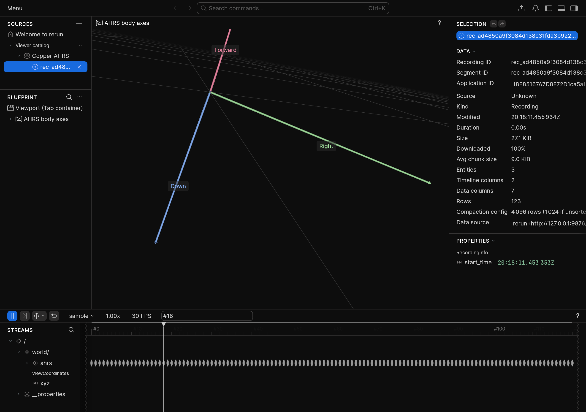

# Visualizing Payloads with Rerun

An attitude estimate is easier to check as three moving arrows than as three
columns of numbers. Copper's `cu-ahrs` task estimates roll, pitch, and yaw from
IMU measurements. Its `AhrsPose` output can also draw the robot's **Forward**,
**Right**, and **Down** axes in Rerun.

A *representation* is a visualization supplied by the payload type. You can use
it in a standalone Rerun recording or open it from Copper TimeTraveler's
debugger. The same conversion serves both workflows.

## Try the AHRS representation

This exercise requires Copper **1.4.0-dev**, Rust **1.98 or newer**, and the
**Rerun 0.43.x Viewer**. The representation API is experimental. Follow the
[environment setup](./setup.md) and
[Rerun Viewer installation guide](https://rerun.io/docs/getting-started/install-rerun/viewer)
first. The example runs on your development machine without an IMU or robot.

Start in a directory where you keep projects, with the Copper Book and Copper
repositories next to each other. If you already have these checkouts, use them
instead of cloning again:

```bash
git clone https://github.com/copper-project/copper-rs.git
git clone https://github.com/copper-project/copper-rs-book.git
cd copper-rs-book/examples/ahrs-rerun
```

The book includes the complete example. Its `Cargo.toml` enables the existing
AHRS renderer through `cu-ahrs/rerun` and uses Copper from the sibling checkout:

```toml
{{#include ../../examples/ahrs-rerun/Cargo.toml}}
```

Here is the complete `src/main.rs`:

```rust,no_run
{{#include ../../examples/ahrs-rerun/src/main.rs}}
```

Run it, then open the resulting recording from the same directory:

```bash
cargo run
rerun ahrs.rrd
```

You should see an **AHRS body axes** view containing pink Forward, green Right,
and blue Down arrows. Select the `sample` timeline and scrub from 0 to 120:
yaw increases from 0° to 90°, while roll stays at 15° and pitch at 20°.
The arrows rotate together and remain perpendicular.



*The Rerun Viewer displaying this example's actual `AhrsPose` representation.
These poses are synthetic inputs to the renderer, not measurements from an IMU
or a run of the AHRS filter.*

The important line is `recording.log("world/ahrs", &pose)`: it passes the Copper
payload directly to Rerun. You do not build the arrows in the application.
`ViewCoordinates::FRD()` tells Rerun that +X is forward, +Y is right, and +Z is
down, matching the AHRS axis convention. The blueprint creates the named 3D panel; it controls the
Viewer's presentation, not the payload.

## How the payload draws itself

The implementation lives in
[`cu-ahrs/src/rerun_components.rs`](https://github.com/copper-project/copper-rs/blob/master/components/tasks/cu_ahrs/src/rerun_components.rs).
`AhrsPose` implements Rerun's `AsComponents` trait: it converts its Euler angles
to a quaternion, rotates the three unit body axes, and returns an `Arrows3D`
component batch with origins, labels, colors, and radii.

This is the existing conversion for the payload:

```rust,ignore
impl AsComponents for AhrsPose {
    fn as_serialized_batches(&self) -> Vec<SerializedComponentBatch> {
        axes(UnitQuaternion::from_euler_angles(
            self.roll.get::<radian>(),
            self.pitch.get::<radian>(),
            self.yaw.get::<radian>(),
        ))
    }
}
```

Here `axes` is the shared helper in that source file. `CuAhrsDebugState` uses
the same helper with the filter's quaternion directly. This gives you two
places to inspect orientation: the message emitted by the task and the task's
internal filter state.

Copper discovers the visualization through an attribute on each type:

```rust,ignore
#[cfg_attr(feature = "rerun", reflect(@cu_rerun::representation::<Self, cu_rerun::views::Spatial3DView>()))]
```

`AsComponents` describes the data; the attribute tells the debugger which view
class to open. Direct `RecordingStream::log` calls use `AsComponents` without
needing the reflection attribute.

## Open the same representation in TimeTraveler

For a complete Copper task graph, use TimeTraveler's integration demo. It feeds
a rotating IMU fixture into the real `CuAhrs` task, records CopperLists, and
starts a replay/debug server. From the parent directory containing your
`copper-rs` and `copper-rs-book` checkouts:

```bash
git clone https://github.com/copper-project/cu-timetraveler.git
cd cu-timetraveler
just demo
```

This requires `just` and the native build prerequisites described in
[TimeTraveler's build instructions](https://github.com/copper-project/cu-timetraveler#building-from-source).
Use a TimeTraveler checkout compatible with Copper 1.4.0-dev and Rerun 0.43.
The demo builds the viewer and replay binaries, records its fixture, and opens
the viewer connected to the server.

Select `ahrs` and inspect its output or task state. Use the **+** action beside
the supported type header (tooltip: **Add type representation to view**) to
open its 3D view. Scrub the recorded timeline and watch the axes change.
The message representation uses `AhrsPose`; the task-state representation uses
`CuAhrsDebugState`.

The demo already enables both required features: `cu29/rerun` enables the
representation debug protocol, and `cu-ahrs/rerun` enables the AHRS conversion.
For your own replay/debug binary, add these features to its existing dependency
entries. Keep them in host/debug builds: the debugger computes a representation
when requested, outside the robot's normal task execution path.

The replay server owns the application types and performs the conversion.
TimeTraveler receives Rerun data and displays it; adding a representation to an
application does not require linking that application into the viewer.
See [Logging and Replaying Data](./logging-replay.md) for the recording and
replay foundations.

## Choose a view for your own payload

`Spatial3DView` is the choice for AHRS axes, not a restriction on Copper.
Implement `AsComponents` for your own type, then choose a view matching the
components it produces:

| Data | View from `cu_rerun::views` |
|---|---|
| 3D points, meshes, or orientation axes | `Spatial3DView` |
| Images and 2D geometry | `Spatial2DView` |
| Scalar values over time | `TimeSeriesView` |
| Text log entries | `TextLogView` |
| Text or Markdown documents | `TextDocumentView` |
| Multidimensional arrays | `TensorView` |
| Geographic data | `MapView` |

Rerun's [view reference](https://rerun.io/docs/reference/types/views) includes
examples and the archetypes each view can display. See the
[`cu-rerun` documentation](https://github.com/copper-project/copper-rs/tree/master/components/libs/cu_rerun)
for the adapter and feature setup. The receiver must support the chosen view
class. The current adapter logs one entity per value; a representation can
combine component batches on that entity.

If the arrows do not appear, check that your Viewer is on Rerun 0.43.x and that
`world/ahrs` is included in the 3D view. If TimeTraveler has no **+** action,
check both replay-server features above and rebuild that server. Enabling only
`cu-ahrs/rerun` is sufficient for the standalone example, but does not enable
the representation RPCs on a Copper replay server.
